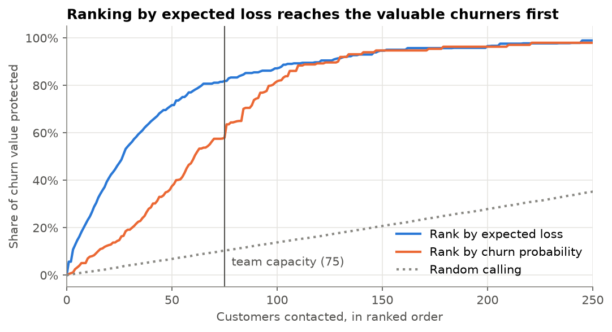
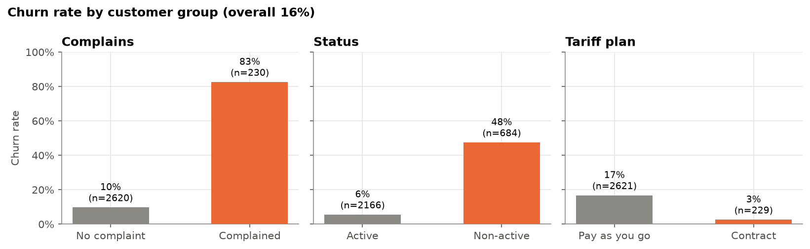
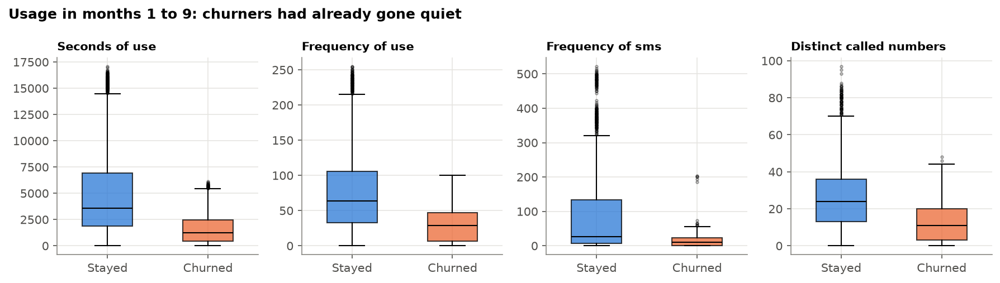
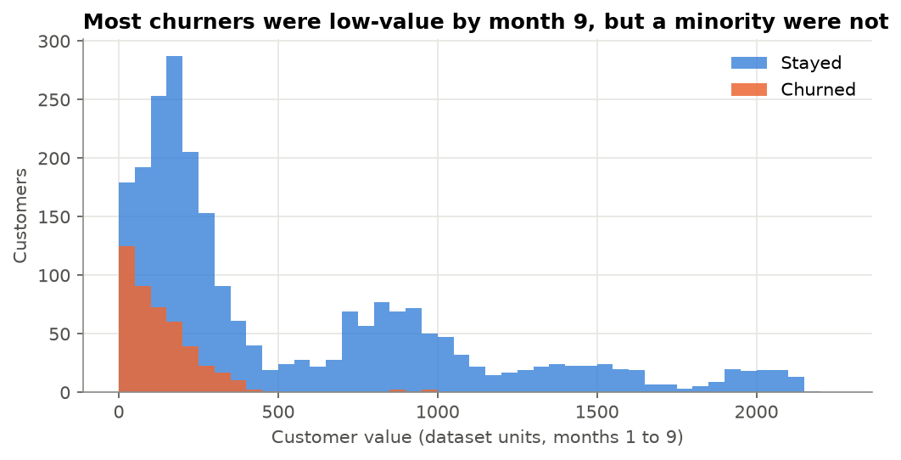
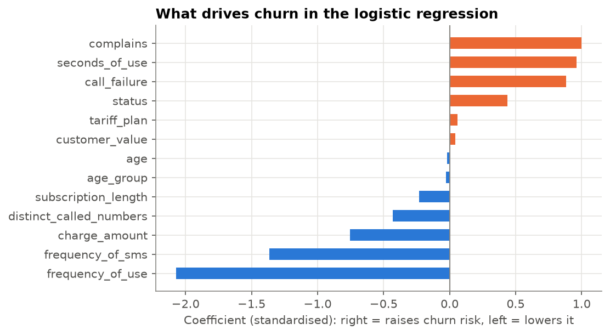
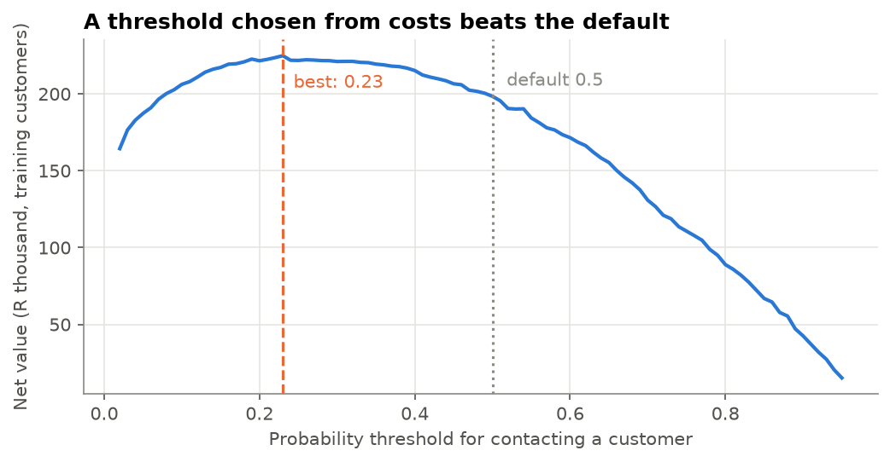
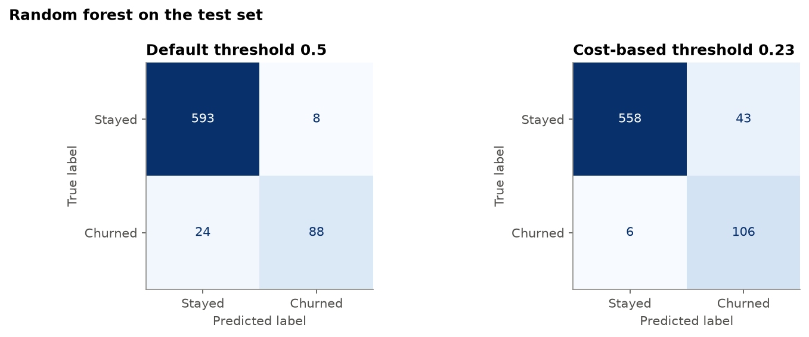
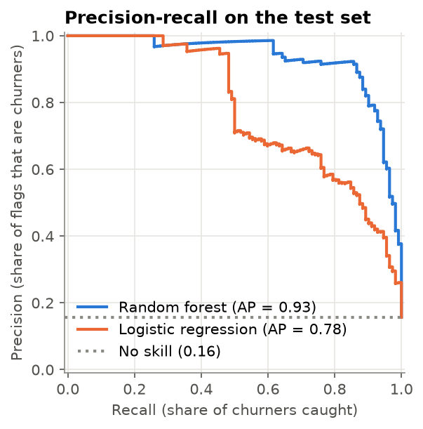

# Churn Prediction: Revenue at Risk

**A churn model that tells a retention team who to call first, and how much revenue that protects.**

Built on 2,850 telecom customers, framed for a South African mobile operator.

| | |
|---|---|
| **Question** | Which customers will leave in the next quarter, how much value is at risk, and who should retention contact first? |
| **Model** | Random forest, threshold set from business costs instead of the default 0.5 |
| **Result** | Catches **95% of churners** on unseen customers (ROC AUC 0.98), with 71% of flagged customers genuine churners |
| **Action** | With capacity for about 10% of customers, ranking by expected loss protects **82% of the value at risk**, against 58% when ranking by churn probability and 10% when calling at random |
| **Output** | [`reports/call_list_top50.csv`](reports/call_list_top50.csv): a ranked call list with a spending ceiling per customer |



## 1. Business problem

**Client and context.** The imaginary client is a South African mobile network operator with a mix of prepaid and contract subscribers. Its customer retention department can take three actions on any customer they believe will churn: give them a call, a discount/bonus data offer, or an early upgrade offer. They are constrained by the number of contacts they can make: for this project I assume the team can contact about 300 customers per quarter.

**Question.** Which customers are most likely to churn in the next quarter, what will be the loss of revenue if no action is taken, and which of those customers should the retention department call first?

**Costs of being wrong.** The prediction model can be wrong in two ways, and both mistakes cost differently.

| Type of mistake | Consequences | Estimated cost |
|---|---|---|
| False Positive | Contacting a customer who would have stayed anyway | R140 (R40 for a call from an agent and R100 for the retention offer) |
| False Negative | Missing a customer who then churns | R3,000 (loss of a R250/month customer for 12 months) |

These costs are estimated values only. The exact figures will vary, but across any realistic range a missed churner costs far more than an unnecessary call, here roughly 20 times more.

**Metric and reasoning.** Because a false negative is significantly more expensive than a false positive, **recall** of the churners is the top target: how many of the customers who actually churned were caught by us? At the same time, calling every single customer gives perfect recall and makes the job impossible for the retention department. Therefore, precision is also measured alongside recall, the decision threshold is set based on the cost numbers rather than the default 0.5, and the final list of contacts is sorted by **expected loss** (product of the churn probability and the customer value). Accuracy is not used as the primary metric because in this case, the majority of customers do not churn, so predicting "no churn" for everyone would provide high accuracy while catching nobody.

**Data note.** The project is based on the Iranian Churn dataset (UCI id 563): 3,150 customers of an Iranian telecommunication company with usage and billing features in the first nine months and the churn status in month twelve. Its "Customer Value" variable is a value score calculated by the operator, not an amount in rand, so financial results are reported in the dataset's own value units; the rand amounts above are given for illustrative purposes only. In the South African setting, I would use the operator's actual usage and billing data: monthly spending, the end date of the contract, recharge data, complaints and network drops. All these data are governed by POPIA.

## 2. Data

**Source:** [Iranian Churn dataset](https://archive.ics.uci.edu/dataset/563/iranian+churn+dataset), UCI Machine Learning Repository, id 563 (CC BY 4.0). 3,150 rows, one per customer, from an Iranian telecom operator.

**Timing:** every feature is aggregated over the customer's **first 9 months**. `Churn` is their state at the **end of month 12**. The three months in between are the planning gap, which matches the business question: score customers at month 9, act before month 12.

| Column | Type | Meaning | Values |
|---|---|---|---|
| `call_failure` | count | Calls that failed during months 1 to 9 | 0 to 36 |
| `complains` | flag | Customer lodged a complaint | 0 = no, 1 = yes |
| `subscription_length` | months | How long the customer has been subscribed | 3 to 47 |
| `charge_amount` | ordinal | Spending band | 0 (lowest) to 10 (documented as 0 to 9; a few customers have 10) |
| `seconds_of_use` | seconds | Total call time | 0 to 17,090 |
| `frequency_of_use` | count | Number of calls made | 0 to 255 |
| `frequency_of_sms` | count | Number of text messages sent | 0 to 522 |
| `distinct_called_numbers` | count | Different numbers called | 0 to 97 |
| `age_group` | ordinal | Age band | 1 (youngest) to 5 (oldest) |
| `tariff_plan` | category | Type of service | 1 = pay as you go, 2 = contract |
| `status` | category | Activity status during months 1 to 9 | 1 = active, 2 = non-active |
| `age` | years | Customer age | 15 to 55 |
| `customer_value` | score | Value of the customer calculated by the operator (units not documented, not rand) | 0 to 2,165 |
| `churn` | target | Customer had left by month 12 | 0 = stayed, 1 = churned |

I renamed the original columns to `snake_case` (several had double spaces) and added a `customer_id` from the row number so every prediction can be traced back to the raw file.

**Is `status` leakage?** A feature leaks when it would not be known at the moment of prediction. `status` is documented as part of the 9-month aggregate, so the operator knows it at month 9: it is a legitimate early warning, not the answer in disguise. Non-active customers churn at 48%, against 6% for active ones. Because this rests on the documentation, Step 5 tests a model without it.

**Duplicates:** 300 rows (9.5%) are identical to another row in every column. With continuous values like seconds of use and customer value, that is almost certainly duplicated records rather than look-alike customers. Left in, a row and its copy could end up on both sides of the train/test split and inflate the test scores, so they are removed in Step 3.

## 3. What the data shows

After removing duplicates there are **2,850 customers**, of whom **446 churned (15.6%)**. A model that predicts "no churn" for everyone would already be 84% accurate, which is why accuracy is not the measure of success here.



**Finding 1: complaints are the loudest warning sign.** Customers who complained churned at 83%, against 10% for those who did not. Non-active customers churned at 48% and pay-as-you-go customers at 17%, against 3% on contract.



**Finding 2: churners go quiet before they leave.** Over months 1 to 9, churners made about 40% as many calls, sent about 20% as many SMSs and called half as many distinct numbers as customers who stayed. The signal is visible three months before they leave.



**Finding 3: most churners are low-value, but the value lost is concentrated.** Churners hold only 4.4% of total customer value, yet the most valuable fifth of churners accounts for about half of all value lost to churn. A call list should weigh how much each customer is worth, not only how likely they are to leave. (Customer value is measured over months 1 to 9, while churners were already cutting back, so it probably understates what they were worth before.)

## 4. Baseline

The data is split 75/25 into training (2,137 customers) and test (713 customers), stratified so both have the same churn rate. The test set is not used until Step 6.

The baseline predicts "no churn" for everyone. On the test set it scores **84.3% accuracy, 0% recall and undefined precision**: it looks good and catches nobody. Every model has to beat it on recall and precision, not on accuracy.

## 5. Models

Two models, compared with 5-fold cross-validation on the training set only:

| Model (5-fold CV) | ROC AUC | PR AUC | Recall @ 0.5 | Precision @ 0.5 |
|---|---|---|---|---|
| Logistic regression (scaled features) | 0.931 | 0.750 | 0.46 | 0.79 |
| Random forest (500 trees) | **0.984** | **0.932** | **0.80** | **0.89** |

ROC AUC and PR AUC measure how well a model **ranks** customers, independent of any threshold, so they are the fair comparison. PR AUC matters most here because it focuses on the minority class (churners). The random forest goes forward.

**What the logistic regression says drives churn** (standardised coefficients, other features held fixed):

1. **Frequency of use** is the strongest protective factor: one standard deviation more calls cuts the odds of churning to about an eighth.
2. **Frequency of SMS** points the same way: active texters rarely leave.
3. **Complaints** multiply the odds of churn by about 2.7.



One coefficient is a trap: `seconds_of_use` comes out *positive*, although churners talked far less. Seconds, number of calls and customer value move together, so the model splits their shared effect in ways that should not be read one coefficient at a time (multicollinearity). The reliable story is the group one: low usage means high risk.

**No class weighting.** I deliberately did not use `class_weight="balanced"`. It would inflate the predicted probabilities, and Step 7 needs honest probabilities to compute expected loss. The imbalance is handled by choosing the threshold from costs instead.

**Robustness check on `status`:** without it, the forest's PR AUC drops only from 0.932 to 0.909, because usage carries much of the same signal. Keeping it is low-risk even if the documentation were wrong about its timing.

## 6. Evaluation

**Choosing the threshold from costs.** With the costs from Section 1 and one extra assumption, that a retention offer persuades **30%** of genuine churners to stay, contacting a customer pays off on average when

`p(churn) x 30% x R3,000 > R140`, so `p > 0.156`.

Scanning thresholds on out-of-fold training predictions confirms it: net value peaks at **0.23**, and anything between about 0.15 and 0.45 earns almost the same. The default 0.5 earns noticeably less.



**Test set results** (713 customers the model had never seen, 112 of them churners):

| Model | Threshold | ROC AUC | PR AUC | Recall | Precision | Customers flagged |
|---|---|---|---|---|---|---|
| Logistic regression | 0.50 | 0.932 | 0.778 | 0.48 | 0.83 | 65 |
| Random forest | 0.50 | 0.983 | 0.932 | 0.79 | 0.92 | 96 |
| **Random forest** | **0.23** | **0.983** | **0.932** | **0.95** | **0.71** | **149** |



Moving from 0.5 to 0.23 catches 18 more churners (106 of 112 instead of 88) at the price of 35 more unnecessary contacts. Given that a missed churner costs about 20 times more than a wasted call, that is the right trade.

**In money terms:** the flagged churners hold 95% of the customer value at risk on the test set. Under the README's rand assumptions, contacting the 149 flagged customers costs R20,860 and is expected to keep about 32 customers worth R95,400, a net gain of about **R74,500 on these 713 customers**.



**Capacity binds.** The team can contact about 300 of roughly 2,850 customers a quarter (10.5%), which is 75 on the test set. The threshold flags 149, so the model needs to say *who first*. That is Step 7.

## 7. From scores to a call list

`expected loss = p(churn) x customer value`

Customers above the cost-based threshold are ranked by expected loss, not by probability alone. On the test set, with the team's capacity of 75 contacts:

| Ranking used | Share of churners' value protected by the first 75 contacts |
|---|---|
| **Expected loss** | **82%** |
| Churn probability alone | 58% |
| Random calling | 10% |


**Retention tiers** (test set):

| Tier | Who | Action | Customers | Actually churned |
|---|---|---|---|---|
| 1 | Top 50 eligible by expected loss | Personal call from an agent with authority to offer an upgrade or discount | 50 | 96% |
| 2 | Next eligible, up to capacity | Targeted SMS or email with a bonus data offer | 25 | 76% |
| 3 | Eligible beyond capacity | Automated low-cost nudge, no agent time | 74 | 53% |
| None | Below the threshold | No contact: it costs more than it is expected to save | 564 | 1% |

**Budget buffer:** the most worth spending on contacting a customer is `p(churn) x save rate x value if saved`. For an average customer (R3,000) at 90% risk that is about R810; at 20% risk, about R180. Tier 1 customers justify a median of about R730 each, so a R140 call plus offer is well inside the margin.

The top 50 list is exported to [`reports/call_list_top50.csv`](reports/call_list_top50.csv), with each customer's churn probability, value, expected loss and spending ceiling.

## 8. Recommendation

1. **Score every active customer at month 9 of each quarter** with the random forest and contact only those above a churn probability of about 0.23. Below that, a R140 contact loses money on average.
2. **Call in order of expected loss, not probability.** With capacity for about 300 contacts a quarter, this reaches far more of the value at risk.
3. **Treat a complaint as an immediate trigger.** 83% of customers who complained left. A complaint should open a retention case the same week, without waiting for the quarterly score.
4. **Watch for customers going quiet.** Falling calls and SMS volume is the clearest early signal. A monthly usage-drop alert would give the team even more lead time.
5. **Measure the save rate.** The 30% save rate is the weakest assumption in this analysis. Run the first quarter as a controlled test (contact a random half of tier 2 and compare churn) to replace the assumption with a real number.

## Limitations

- **Not South African data.** The customers are Iranian and `customer_value` is an undocumented score, not rand. The rand figures rest on stated assumptions (R250 a month, 12 months, R140 per contact, 30% save rate) and show the reasoning, not a forecast.
- **Small dataset.** 2,850 customers and a 713-customer test set. Results would need confirming on a larger, more recent base.
- **One snapshot in time.** The model is trained on one 12-month window. Customer behaviour, prices and competitor offers change, so a deployed model would need monitoring and regular retraining.
- **Value measured during decline.** Churners' value is measured while they were already cutting back, so the value at risk is probably understated.
- **No causal claim.** The model finds who is likely to leave, not why. It cannot say whether a call will change the outcome; only the controlled test in recommendation 5 can.

## Next steps

- Repeat the analysis on the [Expresso churn dataset](https://zindi.africa/competitions/expresso-churn-prediction) (Zindi, 2 million+ African prepaid customers, heavy missing data) to show the approach scales to messy, large data.
- In a South African role, use the operator's own billing and usage records (monthly spend, contract end date, recharge history, complaints, network drop data), processed under POPIA.
- Calibrate the probabilities (for example with `CalibratedClassifierCV`) before using them for money decisions at scale.
- Track the model's precision and the realised save rate every quarter.

## How to run

```bash
git clone https://github.com/vusumuzinkosi/churn-prediction-revenue-at-risk.git
cd churn-prediction-revenue-at-risk
python3 -m venv .venv && source .venv/bin/activate
pip install -r requirements.txt
jupyter notebook
```

Run the notebooks in order. The first one downloads the data from UCI into `data/raw/` if it is not there yet.

## Project structure

```
notebooks/
  01_explore.ipynb     load, data dictionary, cleaning, exploratory analysis
  02_model.ipynb       baseline, logistic regression, random forest, threshold, evaluation
  03_call_list.ipynb   expected loss ranking, retention tiers, call list export
figures/               charts used in this README
reports/
  call_list_top50.csv  ranked call list
data/                  raw and processed data (not committed)
```

*Author: Vusumuzi Nkosi ([GitHub](https://github.com/vusumuzinkosi))*
